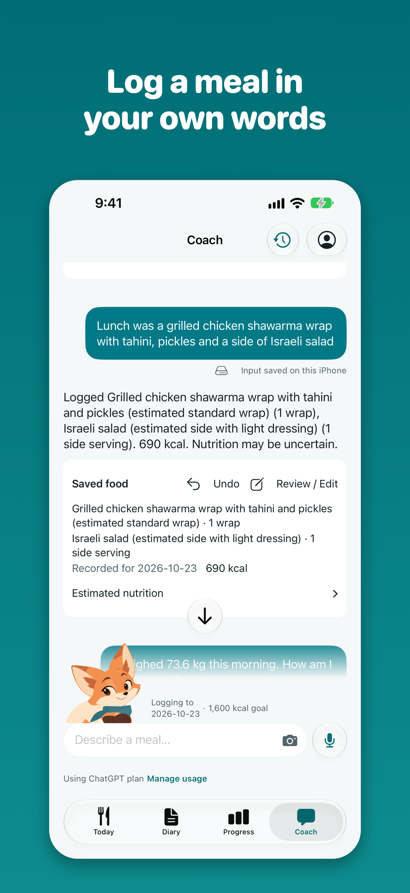
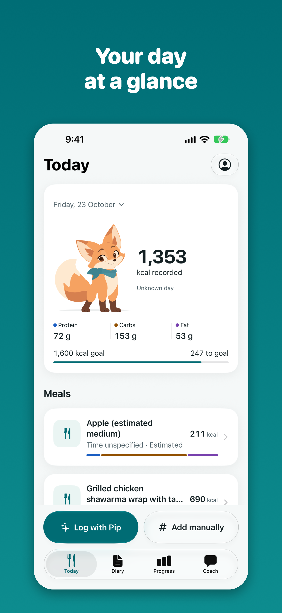
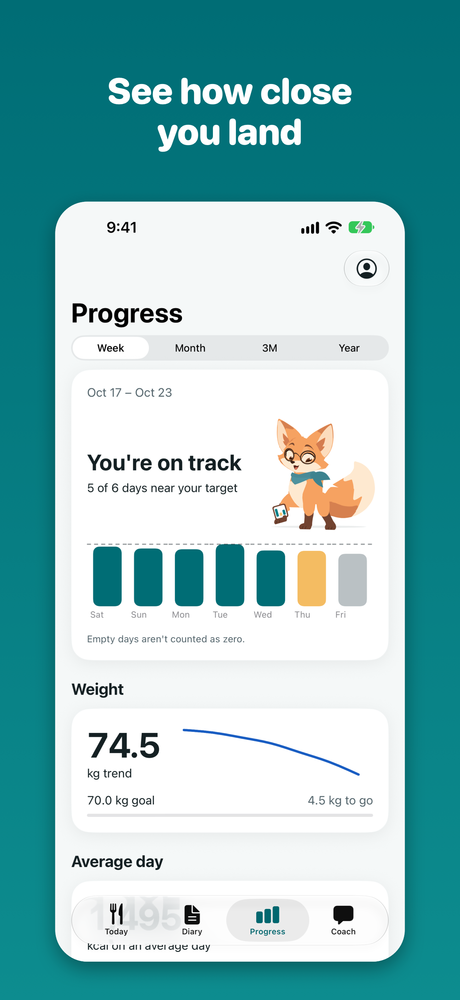

<p align="center">
  
</p>

<h1 align="center">Mivu</h1>

<p align="center"><strong>A private food diary you can just talk to.</strong></p>

Tell Mivu what you ate in your own words, by photo or by voice. It records the
meal with estimated calories and macros, and you can review and fix every number.

Your diary stays on your device. There is no Mivu account, no Mivu server, no ads
and no tracking.

<p align="center">
  
  
  
</p>

## What you get

- **Log the way you talk.** "Two eggs, toast and a coffee with milk" becomes a
  meal in your diary. Weight and workouts go in the same conversation.
- **Fix anything by asking.** Tell Coach to change an amount or a food, or edit
  it by hand.
- **See your day.** Track calories and macros against your targets, with a full
  diary and progress charts.
- **Meet Pip.** Your fox companion sets up your daily targets and reacts as you
  log.
- **Keep your data.** Back up to a folder you choose, or export everything at any
  time.

## How the AI works

Mivu has no AI bill of its own. You connect your own ChatGPT plan through OpenAI's
[Sign in with ChatGPT](https://developers.openai.com/siwc/token-sharing-open-source),
so you don't need an API key.

- Mivu asks before anything is shared with OpenAI, and you can disconnect at any
  time.
- Logging by hand, history, progress and backups all work without ChatGPT.
- On supported iPhones, Apple Intelligence can log meals on-device instead.

Nutrition figures are estimates, not medical advice.

## Run it

### iPhone

You need Xcode 27 or later. The app runs on iOS 26 and newer.

1. Open `ios/Mivu.xcodeproj`.
2. Choose the `Mivu` scheme and an iPhone simulator.
3. Press Run.

To run on a real device, set your own signing team and bundle identifiers.

### Android

The Android app is at an early stage and needs Android 12 or newer. Open `android/`
in Android Studio, or build it from the command line:

```bash
cd android && ./gradlew :app:assembleDebug
```

## What's where

| Folder | What's inside |
| --- | --- |
| [`ios/`](ios) | The iPhone app, written in SwiftUI |
| [`android/`](android) | The Android app, written in Kotlin and Compose |
| [`design-system/`](design-system/mivu/MASTER.md) | Colors, type, components and Pip's artwork |
| [`docs/`](docs) | Plans, design specs and test records |
| [`scripts/`](scripts) | CI checks and build tools |

## Contributing

Pull requests are not accepted at this time. For questions, visit
[mivuapp.com/support](https://mivuapp.com/support).

To find your way around the project, start with these:

- [Product plan](docs/superpowers/plans/2026-10-12-native-diary-mvp.md)
- [Design system](design-system/mivu/MASTER.md)
- [Testing and releases](docs/development/ci-cd.md)
- [Repository rules](AGENTS.md)

## License

The code is licensed under the [GNU AGPL v3.0](LICENSE). The Mivu name, icon and
Pip artwork are not, so remove them before you distribute a modified version. See
the [notice](public/NOTICE.md) for details and third-party credits.
