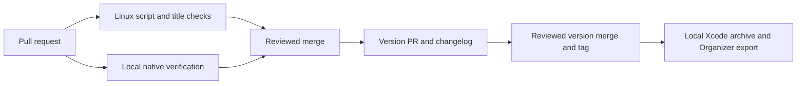

# CI and local delivery

Mivu stays private. GitHub Actions runs short Linux checks only. All hosted jobs
use `ubuntu-slim` with two-minute limits. Native builds, tests, packaging and
signing run on the local Mac; no hosted macOS or self-hosted runner is configured.
This is the owner's approved policy from 2026-10-14.

## Hosted checks

**CI** runs on pull requests and manual dispatch. Its `checks` job runs:

```sh
python3 -m unittest discover -s scripts/ci -p 'test_*.py'
bash -n scripts/ci/native.sh scripts/ci/signed.sh
```

The shell check validates syntax; it does not execute native or signing scripts.
Workflow contract tests inspect every workflow for Slim runners and short limits.
CI has a read-only token, no Apple/provider secrets, and no privileged
`pull_request_target` execution. Checkout credentials are not persisted. New
commits cancel obsolete CI runs. Merges do not repeat the PR checks.

**Commit title** validates Conventional Commit PR titles and reruns on title
edits. **Release versions** runs only on `main`, maintains version/changelog PRs
using the pinned release-please action, and explicitly dispatches CI and title
checks for its token-created version PRs. The configured component branch is
`release-please--branches--main--components--mivu`; unexpected branches fail
before dispatch. The bot never approves or merges a PR.

Keep `MIVU_ACTIONS_USAGE_APPROVED`, `MIVU_ACTIONS_ALLOWANCE_VERIFIED` and
`MIVU_AUTO_PACKAGE_RELEASES` false. These gates protect older workflow revisions;
current workflows contain no native or packaging dispatch. Do not change billing
or budgets without owner approval. Linux CI success proves script/title checks,
not an Apple build, test run, signed product or phone installation.

## Local native verification

Use XcodeBuildMCP on the local Mac with Xcode and an iOS 26-or-newer
simulator. The committed JOSESwift 3.0.0 revision remains enforced. Run focused
native checks for Swift changes and the full native unit/UI scheme before merging
screen/navigation changes. A later source change needs appropriate fresh evidence.
This is a contributor merge rule, separate from hosted branch protection.

Record the exact command, source SHA, UTC time, Xcode/simulator environment,
exit status, named tests, pass/fail/skip counts and result bundle location. An
unavailable native suite is blocked, not passed. Simulator results do not prove
physical camera, haptics, VoiceOver, provider authentication or phone installation.

`native.sh`, `signed.sh` and their short script tests remain available for local
or controlled rehearsals; no workflow invokes them. `native.sh` modes retain
result-bundle and named-test validation. Use a fresh `MIVU_CI_OUTPUT` directory
for each rehearsal so a previous result bundle cannot be overwritten. Signing
scripts are intended for an isolated controlled rehearsal, not ordinary workstation
credential management. Use Xcode/Organizer for normal local signing and delivery.

## Opt-in local Git hooks

Enable the versioned hooks once per repository:

```sh
python3 scripts/ci/git_hooks.py install
```

The installer sets local `core.hooksPath=.githooks` and refuses to replace a
custom hooks path or existing executable hooks. Integrate existing hooks manually
if it reports a conflict. Clones need their own installation; linked worktrees
share repository configuration. Older branches need these hook files to retain
checks after checkout. Git hooks supplement reviewed PRs and are not remote
branch protection.

`pre-commit` checks staged whitespace/conflicts and parses staged Python and shell
files. It runs no test suite or native build and ignores unstaged content.

`pre-push` runs the same quick script tests and shell syntax checks as Linux CI.
The committed check scripts must match the working copy. Deletions need no checks.
Known remote commits are compared with each pushed commit; new branches use their
merge base with `origin/main`. Documentation-only pushes skip native work when
native inputs match that baseline. Missing baselines require native verification.

Native inputs include the entire `ios/` tree and the hook's test helper/recipe.
A native push must check the current `HEAD`, with no dirty or untracked native
inputs. It runs all `MivuTests` units through XcodeBuildMCP in Debug, with parallel
testing off and package versions bound to the committed lockfile. Native child
processes clear Git's repository variables so package checkouts use their own
repositories; SSH, askpass and proxy settings remain available. It chooses an
available iPhone on iOS 26 or newer, preferring a booted device, then the latest
runtime. Missing Xcode, tooling, simulators or valid test evidence blocks the push.

A verified success is reused only for identical native inputs, recipe, selected
Xcode path/version/build, host OS, Mac architecture, toolchain/SDK overrides,
CLI path/version and simulator/runtime. Forwarded `TEST_RUNNER_*` and
`SIMCTL_CHILD_*` names/values affect a digest in the key; raw values are not stored.
A nonempty `XCODE_XCCONFIG_FILE` blocks native verification because it selects
untracked build configuration.
Failures, zero-test and malformed results never enter the cache. A lock prevents
parallel native runs. Source, `HEAD` and environment are checked again after the
run. Evidence, success records and reusable build output live under
`mivu-checks/` in Git's common directory, outside tracked files; each run gets a
fresh result-bundle path. The hook prints that evidence location.

These unit checks do not replace manual full unit/UI verification for screen or
navigation changes, physical-device checks, or independent Ponytail Review before
merge. Report a blocked push as blocked, then resolve its cause and push again.

## Versioning, packaging and signing

Squash merges use the Conventional Commit PR title: `fix: ...` bumps patch,
`feat: ...` bumps minor, and `feat!: ...` or a breaking change bumps major.
Release-please updates `version.txt`, its manifest, changelog and shared Xcode
marketing version. The baseline is `1.0.0`; existing rehearsal tags are preserved.
Bootstrap starts after `4f97261eb10d2af2a1301251c8e46748d7cc0dab`.

Merging a reviewed version PR creates its tag and GitHub release. Version notes
and tags are separate from binary delivery. There is no hosted release packaging,
signing, artifact publishing or TestFlight workflow.

For local delivery, check out the immutable version tag already merged into
`main`, verify its native source locally, and open that source in Xcode. Select
the intended device/archive destination and signing team, then archive and export
through Organizer. Record the exact source SHA, build number, local test evidence
and exported product. An unsigned archive cannot be installed on a phone.

Apple membership, signing identity, provisioning and any required agreements
remain owner prerequisites. Keep signing credentials in the local Apple tooling;
GitHub CI needs no Apple secrets. Any requested TestFlight upload is performed
locally through Organizer. An upload acknowledgement does not prove processing,
tester availability or device installation; inspect those outcomes separately.
Nothing in version automation submits to App Review or distributes a build.



## Historical hosted evidence — 2026-10-12

These results describe the earlier hosted macOS workflows, which were removed
under the Linux-only policy. They do not verify the current source or delivery
path. Historical links and outcomes are preserved below. The [MVP
acceptance matrix](../verification/2026-10-12-native-mvp-acceptance.md) separates
the hosted baseline from local working-tree checks and remaining acceptance gates.

| Evidence | Source and result |
|---|---|
| [PR #4](https://github.com/yakov103/mivu/pull/4) | Merged externally while its CI run was still running. |
| [Main Native CI](https://github.com/yakov103/mivu/actions/runs/38236090700) | Source `7a86d046200fa4e86e5110b96aa31fd479a99822`; macOS 26.6.2 arm64; provenance `2026-10-12T10:29:43.930615Z`; exit 0; 200 passed, 0 failed, 1 skipped. This is the clean hosted baseline. |
| [Unsigned release rehearsal](https://github.com/yakov103/mivu/actions/runs/38238559422) | Run succeeded against the same `7a86d046200fa4e86e5110b96aa31fd479a99822` source; 200 passed, 0 failed, 1 skipped. Test provenance `2026-10-12T10:53:36.332089Z` and unsigned archive provenance `2026-10-12T10:54:17.610489Z`; both exit 0. Five downloaded assets matched release metadata size and SHA-256; ZIP integrity checks passed. The simulator app ZIP SHA-256 is `edf74aba2512397602b2e7cdc34a529723f34483c9bb0c2ad096809640ae1fa8`; the unsigned archive ZIP SHA-256 is `376652240209c6337671c1e945bede0a8f91e3bab441e42a505b6bcc1214857c`. |
| [Private draft release](https://github.com/yakov103/mivu/releases/tag/untagged-746cb4d76e3ed82ebe51) | Tag `v1.0.0-rehearsal.2`; the unsigned device archive is not installable on a physical iPhone. |

The tag-triggered rehearsal did not request signed delivery, so the signed job
was skipped. Required Apple signing secrets remain unavailable; signed delivery
is separately blocked. No signed or phone-installable artifact was produced.
Physical camera, haptics, hardware VoiceOver/accessibility, actual Files-provider
roundtrip, and pilot acceptance remain unverified. The current coach expansion is
underway and is not verified by this sample-diary baseline. Simulator CI and
archive tests do not establish those outcomes.
