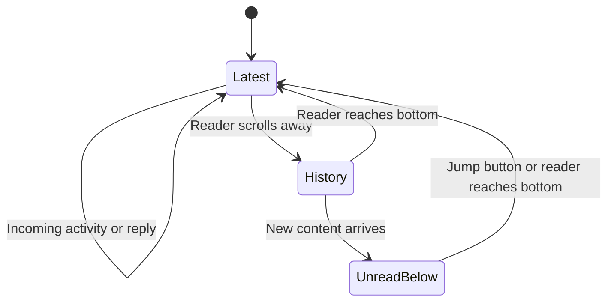

# Coach chat behavior and recovery

Reviewed 2026-10-14. This contract extends the existing Coach/store flow; it does
not introduce another chat service, backend or UI dependency.

## Research and decisions

[Apple's ScrollPosition documentation](https://developer.apple.com/documentation/swiftui/scrollposition)
defines semantic positions and a user-position signal. Edge positioning stays
stable across content-size changes; view identities also support resized lazy
content. Mivu opens at the bottom and follows the latest message's native
identity, with actual viewport geometry deciding whether content is visible.
The reader's position must survive incoming activity while browsing history.

[Stream's native message-list documentation](https://getstream.io/chat/docs/sdk/ios/swiftui/chat-channel-components/message-list/)
separates typing indicators, unread content and jump controls. Mivu adopts that
separation through its existing SwiftUI view. No Stream SDK is installed.

[The function-calling guide](https://developers.openai.com/api/docs/guides/function-calling)
recommends explicit tool contracts, enums, deterministic application work and
strict schemas. Mivu already validates tool arguments and commits receipts with
record changes. Clarification now uses an enum identifying the missing detail;
the app owns the English question, so arbitrary model text cannot claim a save.
Schema conformity alone does not establish a persisted record or correct live
tool selection.

## Scroll contract

- Open completed conversations at the latest content, including after profile
  loading and relaunch.
- Follow new input, thinking, reading, saving, replies and linked actions while
  the reader is at the bottom. Defer movement while a touch is active.
- Preserve intentional history browsing. Track native user positioning separately
  from an app-requested scroll; animation alone does not identify intent.
- Show **New message** only when new content is below the viewport and the reader
  is viewing history. Never show it while the latest content is visible.
- Clear unread state at the bottom. Tapping the button returns to the bottom and
  resumes following.
- Keep the composer reachable with Dynamic Type, the keyboard and reduced motion;
  use native controls with at least 44-point targets.

## Food and clarification contract

A new consumption statement refers to new intake. An earlier request to keep a
named review unaccepted stays scoped to that review. When enough context is
available, Coach can log an explicitly uncertain estimate. Unknown exact grams
or milliliters alone should not block logging. Ask when the food, serving, day,
meal reference or workout is genuinely ambiguous.

For a clear “another,” “one more,” or “same again,” reuse the most recent matching
committed food quantity and unit as an uncertain estimate. An unaccepted review
is never a consumed-food default. Explicit current amounts or labels, or visible
evidence of a different food/serving, override history. A new photo of the same
food without a measurable amount does not by itself discard a clear saved portion.

Interpret the current photos and description together. Estimate a visible
serving first, then a labelled typical serving or mixture when identified but
unmeasurable. A cocktail photo does not verify hidden alcohol or mixer quantities.
Saved-food confirmations include the actual recorded quantities and units so
the user can see and correct assumptions.

The context projection keeps the same bounds: 14 stored tracking days, at most
40 eligible meals within 24 KB, 12 recent turns within 8 KB, and 60 KB overall.
When meals compete for space, recent entries get priority; retained entries are
still presented in their original order. Omitted record references remain available
for retrieval through existing tools. This adds no separate memory store or model
request, and does not replay previous photos. These are byte limits on the diary
projection, not a claim that the entire multimodal request uses 60 KB or a fixed
number of tokens.

`ask_clarification` accepts an allowed `kind`, not free-form question prose.
Its app-owned response is persisted as a completed conversational reply through
the existing turn store. It records no food or other mutation; the user's answer
is a new turn with the prior question available in context. The tool must be used
alone, before any current-turn writes. Mixed writes or an earlier receipt are
rejected, while already committed records remain intact.

Save confirmations continue to come from successfully committed receipts.
Read-only summaries come from the diary. Missing nutrients and days remain
unknown; estimates stay labelled, and retries reuse committed operation results.

## Known evidence and remaining acceptance

The owner's two yogurt messages completed without a food receipt. The displayed
reply cannot reveal the original model's prose or earlier read-tool choices. A
confirmed source path discarded safe clarification prose; prior-review intent
spillover remains a hypothesis. The fix makes clarification explicit and narrows
that intent contract. Fixture success does not prove live provider selection.

The current catalog has 29 tools. The function-calling guide suggests evaluating
smaller initial tool surfaces as a soft accuracy recommendation. This change
preserves the approved manual-edit catalog; it does not add speculative intent
routing or a tool-search subsystem. Validate natural intake and corrections with
the owner's real account before changing that boundary.

The offline checks completed, and the owner reconnected the iPhone for a focused
live pass. Remaining device acceptance must cover:

1. One new yogurt statement after an unaccepted review: one new record or a
   visible question, then exactly one record after its answer.
2. No unread button at the bottom during thinking and reply arrival.
3. Mouse-wheel history browsing through Mirroring: retain position, show the
   button when new content arrives, and resume following after tapping it.
4. Relaunch into the latest conversation with the same saved records.

Exact sources, counts, artifacts and the broader device checklist belong in
[the verification record](../verification/2026-10-14-coach-edit-parity.md) and
[Coach edit parity](coach-edit-parity.md). On 2026-10-14 the owner approved merging
with the remaining fixes and device checks tracked in
[#13](https://github.com/yakov103/mivu/issues/13). Integration does not establish
those unchecked workflows as passed.
