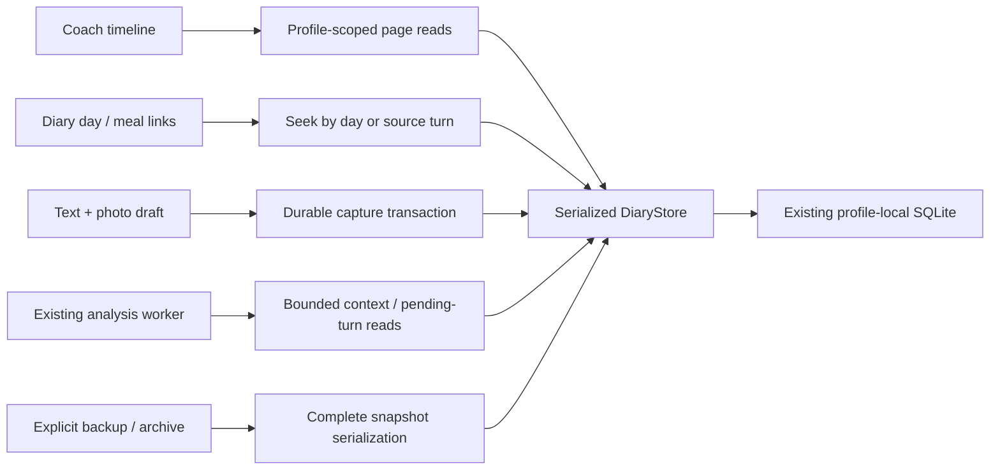

# Coach: camera-first capture and a continuous, paged conversation

Date: 18 October 2026. Status: written design awaiting owner review.
Baseline: `6fca93d99802367553da13b17c3b43b91d4dde7e` on main.
The owner approved the behaviour below and requested this researched specification.
Implementation and its plan have not started. This specification supersedes the
earlier suggestion of separate daily conversation threads.

Related contracts: [conversational Coach](2026-10-12-conversational-coach-design.md),
[visual system](../../../design-system/mivu/MASTER.md),
[CI and delivery](../../development/ci-cd.md), and the repository
[animation skill](../../../.agents/skills/mivu-animation/SKILL.md).

## 1. Intent and approved decisions

Make recording food feel as immediate as sending a message, while preserving a
trustworthy diary and smooth navigation through years of conversation history.
Keep Precision Glass, semantic light/dark colours, native controls and painted Pip.

The owner's decisions are requirements:

- One continuous Coach conversation per private diary profile, with WhatsApp-style
  tracking-day dividers. A divider follows Mivu's existing recognition of a new
  waking/tracking day, not an independent midnight timer.
- Initially load recent messages; load older history on demand with bounded memory.
- Diary can open the conversation around a day or the message behind a saved meal.
- Reading an earlier day never silently changes the target of a new submission.
  Undated input follows the active tracking day at capture.
- Free text can backdate an entry: “I forgot pasta yesterday” and “add this to
  October 12” remain normal ways to log food.
- Camera tap opens the camera directly. Choosing an existing photo remains available
  inside that flow. Photos return to the composer for inspection before sending.
- Interpret relative dates against the message's saved capture time and timezone,
  including offline retries. Ask only when the intended date or target is ambiguous.

Success means fast local capture, correct dates and quantities, stable scrolling,
bounded history/photo loading, and no loss or duplication of existing data.

## 2. Research and decisions for Mivu

Research accessed 18 October 2026. These are documented product patterns, not a
hands-on usability study or a claim that competitors' recognition is accurate.
Their subscriptions, platforms and model limits are not Mivu requirements.

| Primary source | Documented pattern | Decision for Mivu |
|---|---|---|
| [MyFitnessPal Meal Scanner](https://support.myfitnesspal.com/hc/en-us/articles/360045761612-How-to-use-the-Meal-Scanner) | iOS capture or photo upload; suggestions, serving adjustments and adding missed food | Camera/library access in one flow; inspect quantities and correct missing food through existing editing |
| [Cronometer Photo Logging](https://cronometer.com/blog/photo-logging/) | Review and swap foods/servings; suggestions for easily missed ingredients such as oils or condiments | Treat photo analysis as an editable estimate; surface genuinely uncertain ingredients without silently adding them |
| [MacroFactor food logging](https://macrofactor.com/ai-food-logging/) | Photo input can be combined with a description | Preserve a single photo-plus-text submission: “half the plate” or “no dressing” qualifies the image |
| [Lose It Snap It](https://loseit.zendesk.com/hc/en-us/articles/47771695186580-How-to-Use-Snap-It) | Food-level serving edits after recognition | Keep portion correction close to the result; reuse Mivu's existing meal editor and revision guards |
| [ChatGPT history](https://help.openai.com/en/articles/10056348-finding-your-chats-projects-and-files-in-chatgpt) | Older conversations remain discoverable even when absent from the recent list | An unloaded day or message is still reachable through indexed day/record links |
| [Apple Photos picker](https://developer.apple.com/videos/play/wwdc2023/10107/) | System picker shares only selected assets without requesting general library access | Use PhotosPicker for existing photos; do not build a full-library reader |
| [Apple progress feedback](https://developer.apple.com/design/human-interface-guidelines/progress-indicators) | Accurate status, useful stalled-state feedback and interruption where safe | Separate local save, analysis and review states; retain drafts and offer safe retry |
| [Google PAIR feedback/control](https://pair.withgoogle.com/guidebook-v2/chapter/feedback-controls/) | Editable results and manual fallbacks support user control | Preserve free-text corrections and direct editing; a model response is never the source of truth for a saved mutation |

The product additions justified by this research are a combined photo/text draft,
clear date/portion/status receipts, and convenient correction. Existing serving
reuse, meal editing and manual logging remain available. This work does not add
barcode infrastructure, voice capture, recipes, subscriptions, social chat,
generated confidence percentages or another recognition provider. General keyword
search is separate; the first history navigation uses tracking days and record links.

## 3. Architecture choice

Two approaches were considered:

1. **Continuous timeline with automatic database paging — selected.** Matches the
   approved interaction, supports direct historical jumps, and bounds the working
   set. Requires indexed reads, targeted writes and stable scroll anchors.
2. **Continuous timeline with an explicit Load earlier button.** Makes fetches
   predictable but adds repeated taps. Retain an accessible load/retry action as
   a fallback, rather than making it the primary history interaction.

Displaying a short suffix of a fully loaded conversation does not meet the
performance requirement. Separate daily threads were superseded by the owner's
continuous-chat decision.

### Existing code that makes this architectural

- `CoachHistoryWindow.swift` currently windows 20 turns after the profile data is
  already loaded. `CoachViewModel.turns` reads `snapshot.coachTurns`.
- `DiaryDatabase.readSnapshot` loads all `coach_turn` and `coach_photo` rows and
  reconstructs photo bytes. It also hydrates historical meal photos.
- `DiaryDatabase.write` validates and reconciles complete snapshots, including the
  entire conversation. A partial page is not a valid replacement snapshot.
- `DiaryStore.current`, profile selection and several worker/refresh paths use
  complete snapshots. Adding a page query without removing those hot-path loads
  would leave the performance problem in place.
- `coachContext` currently takes a bounded suffix of other turns, independent of
  their position relative to the turn being processed. New context queries must
  exclude future queued turns as well as remaining independent of the viewport.
- `PhotoInput` contains camera/library actions; the Coach camera icon first opens
  that general sheet. The direct camera flow needs a dedicated presentation owner.

Keep the existing profile-local SQLite database and serialized DiaryStore writer.
Do not introduce a remote conversation service or a second database writer.

## 4. Conversation chronology and food dates

Three identities must stay distinct:

| Identity | Meaning | Can viewing history change it? |
|---|---|---|
| Conversation position | Immutable append sequence of the submitted exchange | No |
| Conversation tracking day | Active tracking-day assignment captured with that exchange | No |
| Food/weight/workout date | Target resolved from explicit input or existing day rules | No; only an intentional record operation can change it |

A message sent during the active October 18 tracking day saying “I forgot pasta
on October 12” stays under October 18 in chat. Its meal receipt says October 12,
and Diary totals change for October 12. A backdated meal must not insert an old-day
divider into the latest conversation or move the original message.

Persist capture instant, capture timezone and active day at acceptance, before
awaiting inference. “Yesterday” is resolved using that captured local date; waking-
day ambiguities continue to use Mivu's existing explicit day-choice behaviour.
Later processing, travel, profile timezone changes and scrolling do not reinterpret
the message. Do not infer consumption time from EXIF or invent a precise meal time
when the user supplied only a date.

Support explicit named dates, relative dates and corrections through existing
grounded tools. Ambiguous numeric dates, missing years with multiple plausible
targets, or an unclear “that meal” require a focused clarification before related
writes. A message naming multiple dates can produce separately dated records with
separate receipts. Retry uses the same operation identity and captured date context.
Preserve intent as well as date: “What did I eat on October 12?” is a read request,
not new consumption. Suggestions or future plans do not become intake merely
because they contain a food and a date.

### Divider rules

- A committed active-tracking-day transition produces a divider at the latest end
  of the chat; the first exchange in that segment retains that assignment.
- At the latest end, show the newly active day's divider even before its first
  message. Do not interrupt someone reading an earlier region to reveal it.
- Dividers are presentation derived from stable day/turn metadata, not assistant
  messages. Use stable IDs and explicit dates; relative labels may supplement dates.
- Crossing a page edge must not duplicate or omit a divider. Fetch small neighbour
  metadata when needed; no historical photo hydration is required to decide it.
- Creating an old tracking day solely to backdate a record does not activate it or
  create a new current-chat segment.
- A day with no chat has an explicit empty result in Diary navigation. Never
  substitute the nearest day's messages and imply they belong to that day.

## 5. User flows

### 5.1 Open Coach and browse history

Open the latest 20 exchanges, ordered chronologically. An exchange includes the
user submission, its reply/status and structured action receipts. Keep an exchange
together when paging so a reply is not orphaned from its input.

Scrolling near the upper edge prefetches the previous 20 exchanges. A compact edge
indicator represents a real request; retain the current content on failure with an
accessible retry action. Deduplicate concurrent requests. Reaching the true start
stops paging without an endless spinner. Loading history never modifies diary data.

Use a bounded window of at most five pages (100 exchanges) and small neighbour
metadata. Evict a distant page only after preserving the first visible stable row
ID and offset; keep the visible/focused exchange. Disable conflicting eviction
during interactive scrolling. Reload evicted pages in either direction as needed.
These are initial design budgets, validated on hardware rather than a performance
claim about the current app.
The five-page budget includes prefetched results. Reserve capacity before issuing
a fetch; defer it if a safe distant-page eviction is not possible. Do not accumulate
pending page results outside that budget while the user keeps scrolling.

Preserve the current distinction between following the latest conversation and
reading history. Incoming background replies must not pull a reader away; use a
New message / Jump to latest action. Sending from an older viewport appends at the
latest end using the active day without reassigning the viewport's historical day.
Preserve the existing history-reading position and reveal the new-message action.

The Coach toolbar has one History action. Its sheet lists days containing chat,
with date and a short text preview, in recent-first pages of 30 days. A date picker
can jump directly to an older day; it does not enumerate every message first.
The composer retains the current draft while browsing this sheet or the timeline.

### 5.2 Open from Diary

- A Diary day's **Open chat** loads a 20-exchange window at its first conversation
  exchange, scrolls to the correct divider and briefly highlights the destination.
- A saved meal's **View conversation** uses its persisted originating turn/submission
  relationship to load a window around that exact exchange. This can be on another
  conversation day when the meal was backdated.
- The history window can then load older or newer pages. **Jump to latest** is one
  action, with the draft retained.
- No chat for the requested day, no attributable source for a legacy meal, a removed
  profile, and a missing/deleted target have distinct honest empty/error states.
  A record without a source link does not get a fabricated one.
- Navigation uses stable profile/day/turn IDs, never list offsets or a rendered
  message string. A stale cross-profile request cannot open another profile.

### 5.3 Camera first, library alongside it

Tap camera → request camera access when needed → full-screen live camera. The
screen has shutter, close, and a clearly labelled photo-library affordance. Use a
camera presentation owner built on supported AVFoundation capture primitives;
Apple's [AVCam sample](https://developer.apple.com/documentation/avfoundation/avcam-building-a-camera-app)
is a reference for session lifecycle, not a requirement to copy its complete UI.
Use native PhotosPicker for library selection. No extra source-choice sheet first.

Capturing a photo returns to the composer with a preview. Retake replaces that
attachment; Remove removes it. Text can explain amounts or exceptions. Library
selection can add several photos within the existing eight-attachment limit.
Send submits text and selected photos as one operation; taking a photo never
automatically submits, creates a meal, or starts remote analysis.

On denied/restricted camera access or no camera, keep Choose photos and Close
usable. Offer Open Settings only when it can help. Cancelling either picker retains
existing text and attachments. Respect the current import size/normalization rules.
Reject only the failed import with an actionable message; retain successful images.
Cancelling the library returns to the camera flow; completing a selection returns
to the composer. Closing the camera returns to the composer without new attachments.
An interrupted camera session has a visible retry/close state instead of a frozen
preview. Opening or switching to the camera never uploads preview frames.

Do not inspect the user's library to build a “latest photo” thumbnail. Use a neutral
library symbol or a thumbnail already explicitly selected by the user. Pause the
capture session when covered/backgrounded and release it on dismissal. Late import
results are checked against presentation generation and profile ownership before
being attached. Keyboard focus is restored without replaying Pip feedback.

### 5.4 Understand and correct a result

The receipt is a compact native card derived from committed records and typed
analysis state. It exposes the target date, food/portion summary, available calorie
and macro estimates, and the appropriate Review or Edit action. Long meals expand
through the existing meal detail screen rather than becoming a wall of chat cards.

- **Saved on this iPhone** acknowledges the durable input capture; it does not mean
  that recognition, a food-record write or remote backup synchronization completed.
- **Analyzing**, **Waiting for connection**, **Needs retry** and **Needs review** reflect
  actual state. Do not advance fake percentages or wait for a character gesture.
- An estimate is visibly an estimate. Unknown nutrition remains unknown, not zero.
- Structured write receipts determine whether food changed. Assistant prose cannot
  invent a saved meal, verified quantity or successful correction.
- Correct a portion, remove a mistaken ingredient or add a missed food in the existing
  editor, or use free text. Record revisions prevent stale corrections. Unaccepted
  proposals do not overwrite current committed items or change existing totals rules.
- Offer a short clarification for an important unknown ingredient/quantity; never
  silently add guessed oils or condiments. Preserve current reasonable photo-portion
  estimation and committed-serving reuse instead of forcing extra questions per meal.
- Corrections update the same record and historical totals; retry/re-observation does
  not create duplicate food. A failed correction leaves the last committed meal intact.

## 6. Data ownership and query contracts

| Existing owner | Scope of the change |
|---|---|
| `CoachView`, `CoachViewModel`, `CoachHistoryWindow` | Paged timeline state, edge fetches, status deltas and stable anchors |
| `DiaryStore`, `DiaryDatabase` | Versioned metadata/indexes, page/seek queries, targeted transactions and worker reads |
| `DiaryViewModel` and normal diary readers | Explicit projections instead of a complete cached conversation/photo graph |
| `HistoryView`, `MealDetailView` | Day/source-turn navigation and on-demand photo access |
| `PhotoCapture` and import preparation | Direct camera presentation, system library picker and draft ownership |
| Existing archive/backup owners | Complete consistent exports and compatible restores, separate from viewport data |
| Companion presentation/runtime integration | Preserve existing submit/receipt identity and eligibility; no new character assets |

### 6.1 Production projections and indexed reads

Introduce explicit read projections such as `CoachPage`, `CoachExchangeSummary`,
`CoachDayPage` and `DiaryReadModel`. A projection is not a partial `DiarySnapshot`.
The archive snapshot remains the complete interchange format. Replace the selected
profile's complete cached graph on ordinary UI paths with identity/revision metadata
and the projections needed by the active screen.

Database metadata needs an immutable per-profile append sequence, capture instant,
capture timezone, conversation tracking-day reference and queryable work state.
The existing `ordinal` may serve as sequence after migration makes it immutable
and uniquely indexed. The display order does not use a mutable food date or the
device wall clock. Add indexes for sequence, day/sequence, pending state/sequence,
photo parent and originating record relationships.

Required store capabilities, with names finalized in the implementation plan:

| Capability | Contract |
|---|---|
| Latest / before / after page | 20 exchanges; opaque exclusive sequence+ID cursor; hasEarlier/hasLater; profile and timeline generation |
| Window around turn | At most 20 exchanges around a stable ID, with both-direction cursors |
| Window at day | Seek indexed conversation day, or return no-chat; no oldest-to-newest walk |
| Day index | 30 preview-only rows per page; no full transcript/photo fetch |
| Photo content | Small thumbnail by visible ID; original by explicit viewer/analysis request |
| Pending work | Next eligible turn by stable order/state, independent of loaded pages |
| Model context | Bounded preceding exchanges and grounded record reads, independent of viewport |

Use keyset cursors, not growing OFFSET scans. Page results include a small boundary
neighbour sufficient for dividers. Track a separate timeline generation for restore,
profile replacement and destructive timeline changes; normal message-state updates
do not invalidate the entire scroll window. Merge fresh visible-turn deltas by ID.
Profile selection epochs still reject obsolete work.

### 6.2 Targeted writes and complete-data boundaries

New chat capture/status/receipt transactions append or update only the affected
rows under the existing serialized writer. Meal/progress mutations preserve their
existing atomicity and expected-revision checks and publish targeted invalidations.
Never pass a paged window to complete-snapshot reconciliation, and never interpret
an unloaded row as deleted. A write increments the same profile revision/lineage
contract used by backup and stale-write guards.

The complete cached snapshot and `readSnapshot`/reconcile hot paths must be removed
from ordinary profile loading, Coach refresh, worker selection/context and the
mutation paths they invoke. Replace affected callers with validated projections
and targeted database operations. That includes avoiding historical meal-photo
hydration during Coach startup. This caller migration is part of the feature's
correctness scope, not a later optimization.

Validate ownership, relationships, quotas and changed records at transaction
boundaries; schema constraints and revision checks retain the integrity previously
provided by whole-snapshot validation. Do not simply remove validation to make
paging fast. A test must demonstrate the number of conversation payloads decoded
and original photo bytes fetched is bounded on the actual startup/send/worker paths.

Complete snapshots remain necessary for archive/import, existing backup format and
migration validation. Run those as explicit consistent-revision operations, off
the main actor. Keep complete data local, size-limited and outside the UI cache.
Backup serialization can walk batches of source rows but must include the entire
profile, not only loaded history. Preserve expected-revision, deletion/tombstone,
file-identity/replacement and backup-acknowledgement protection. Backup completion
does not claim remote provider synchronization; typing/scrolling do not wait for it.
Create a consistent export view without holding the live writer across a long
serialization or Files-provider operation; its output revision and eligibility for
acknowledgement must be checked separately. Use bounded background work rather
than yielding an inconsistent mixture of revisions. Only the existing serialized
store may write the live profile.

### 6.3 Model context is not the visible page

Keep one continuous conversation across day dividers. Retain the existing bounded
recent-dialogue budget (up to 12 preceding exchanges and its byte limits), profile
preferences and grounded diary tools. Only exchanges preceding the processed turn
are eligible; later queued submissions cannot alter an earlier request's meaning.

Direct references to an old meal/turn resolve by ID with bounded relevant records,
even when outside the recent context or loaded pages. An ambiguous referent asks a
clarification. Explicit historical dates use indexed record/day queries rather than
assuming the last 14 days contain the target. Never feed the full scrollback to the
model, or let a day jump change the context of an already captured operation.

### 6.4 Photos and memory

Page reads return photo identifiers and small metadata, never original BLOBs. Decode
display-sized thumbnails off the main actor; key their cache by profile/photo/
requested size and revision. Start with a 16 MiB decoded-thumbnail cache budget,
two concurrent decode/import jobs, cancellation for offscreen requests and cache
purging on memory pressure. Originals are loaded only for an explicitly opened
viewer, the bounded attachment draft or the selected inference job. Reuse current
vision resizing/byte budgets; do not invent a second upload/processing pipeline.

The normal conversation working set is independent of history length. The bounded
eight-photo draft and an explicit full-profile export are separately measured
exceptions; they cannot become permanent conversation cache entries. No per-frame
database or image processing is introduced.

## 7. Existing-data migration and failure handling

Use a versioned, idempotent SQLite migration within the existing profile format.
Current database setup is additive and has no explicit user-version contract;
introduce one without changing archive schema 1 just for page metadata.

1. Preserve stable turn, meal, submission, receipt and photo IDs and their bytes.
2. Backfill immutable conversation order from the existing ordinal, with stable ID
   as a tie-breaker if legacy data requires it. New appends never renumber old rows.
3. Prefer a turn's saved active-day/capture metadata for its conversation segment,
   never a retrospectively resolved meal date. For a legacy turn without a usable
   day reference, use its saved capture timezone/local date as an explicitly inferred
   display label; do not fabricate a tracking day or change diary totals.
4. Build typed metadata/indexes in bounded batches without decoding photo BLOBs.
   Validate counts, relationships, required metadata and representative lookups.
5. Commit migration atomically. Interruption, insufficient disk, malformed source
   or validation failure rolls back to the intact prior profile. Show a recoverable
   loading error; never replace data with an empty conversation.
6. Import/restore rebuilds derived indexes and timeline generation. Complete export
   includes all history and photos. Background tasks are cancelled/epoch-checked
   across profile selection, restore, sign-out and profile deletion.

Retain existing handling of before-day-choice captures: their original conversation
position/day evidence stays stable while an explicit choice resolves the record's
target. A clarification does not reshuffle old message order.

## 8. Presentation, accessibility and motion

Keep the current native shell and restrained Apple-glass treatment. Use clear
user/reply alignment, readable text, selectable/copyable messages and compact
structured receipts. The active logging day remains visible in the composer area
while a historical region is open. Status is communicated by text/icon as well
as colour; 44-point targets and large-text scrolling remain required.

Load indicators occupy stable edge space. Prepending pages and late thumbnail
decodes do not animate the entire list or alter the reader's anchor. Day jumps may
briefly highlight the target; Reduce Motion uses a static highlight. VoiceOver
announces completion of a requested page once, preserves the focused message,
and has explicit Load earlier/Load later/Jump to latest actions. Loading itself
does not seize focus or repeatedly announce day dividers.

Pip remains a decorative living companion with current Lottie assets and policy.
History requests and thumbnail loads do not emit submit/saved gestures. Only
accepted input and durable receipts follow the existing feedback contract. Hidden,
camera-covered, background, reduced-motion, low-power and thermal policy still
apply. Reuse the repository animation skill for any affected lifecycle wiring.

## 9. Acceptance and evidence

These are implementation requirements, not results already obtained. Record exact
source, environment, named checks, counts and unresolved gates. Use XcodeBuildMCP
for native work and the existing CI/delivery contract; do not substitute hosted
Linux checks for native UI evidence.

| Scenario | Required observable result |
|---|---|
| Open camera, authorized / first use | Live camera is first destination after any system permission prompt; no source-choice sheet |
| Denied camera / no hardware | Existing-photo selection and cancellation work without camera permission |
| Capture/library/retake/cancel | Correct draft preserved; no send until Send; eight-photo limit; partial import failure retains successful selections |
| Photo plus “half / no dressing” text | One captured operation; current combined evidence/portion rules retained |
| Late picker result after profile switch | No attachment or data appears in the newly selected profile |
| Existing day transition, including after midnight | Divider follows committed Mivu day recognition, not an independent calendar timer |
| Backdate to yesterday / explicit old date | Message remains at append position; receipt and totals use the intended day |
| Delayed inference and travel | Original captured date/timezone semantics retained |
| Ambiguous date or target | Focused clarification before related writes, without unrelated record mutation |
| Startup with 100 versus 10,000 exchanges | Latest page decoded; no full historical photo BLOB hydration; equivalent bounded working set |
| Repeated upper/lower edge paging | No duplicate/missing exchange or divider; one in-flight request per edge; anchored reading position |
| More than five pages traversed | Distant pages evicted and reloadable; visible/focused content and draft retained |
| Day/turn seek near oldest data | Indexed window fetch, not loading every intermediate page |
| New reply while browsing / send while browsing | Reading position retained; Jump to latest available; current-day capture unaffected by viewport |
| Diary day / backdated meal links | Correct chronological region / exact source turn; no source fabricated for legacy records |
| A page fails to load | Existing content/draft remains; edge retry; failure is distinct from end-of-history |
| Send or correction fails / retry | No false success and no duplicated food; prior committed values retained |
| Worker has many pending turns | Bounded queue selection and context; no future-turn leakage; processing survives page eviction |
| Migration, interrupted migration and restore | IDs/photos/history intact; rollback on failure; stale cursors/tasks rejected |
| Full export after only one page loaded | Every turn/photo retained and a roundtrip restores them; unloaded rows not deleted |
| Profile/delete/backup races | Existing ownership, revision, lineage, file identity and deletion guards remain effective |
| Light/dark, largest text, VoiceOver, Reduce Motion | Composer and camera/library/record actions reachable; focus and status understandable |
| Pip through paging/camera/background | No history-triggered success, stale replay or unrelated-pose transition |

Profile startup-to-first-page latency, day-jump latency, main-thread stalls, image
decode work and resident memory must be measured on a physical iPhone with small
and near-limit synthetic histories. Instrument SQL row/payload/BLOB reads as well
as UI measurements: a fast warm run cannot conceal an unbounded initial load.
Fixtures with 100 and 10,000 exchanges must respect the existing row and 350 MB
profile-size limits; use a representative bounded set of small synthetic photos.
Hold non-chat diary contents constant when comparing history sizes, and measure
explicit exports separately from the normal conversation working set.
Initial acceptance budgets after migration are: first usable latest page within
2 seconds on a cold launch and 500 ms on a warm reopen; local edge-page fetch and
application within 200 ms at the 95th percentile; visible anchor displacement no
more than 2 points after prepending. These are proposed hardware targets, not
current measurements. Exclude system permission dialogs and separately instrument
the one-time migration. Record device, thermal state, dataset and cold/warm setup.
Verify indexed query plans and that viewport changes do not trigger whole-profile
rehydration. Do not claim 60/120 fps, instant startup or hardware camera acceptance
from simulator screenshots. Physical camera permission/capture and interruption
need device testing; simulator fixtures cover deterministic app-state assertions.

## 10. Written review boundary

The approved behaviour is represented above; the new detailed storage contracts,
research-driven receipt refinements and migration requirements are now available
for review. After approval of this written spec, create the implementation plan
with file-level tasks, regression-first checks, migration sequencing and the chosen
execution method. This document does not authorize skipping that plan review.
