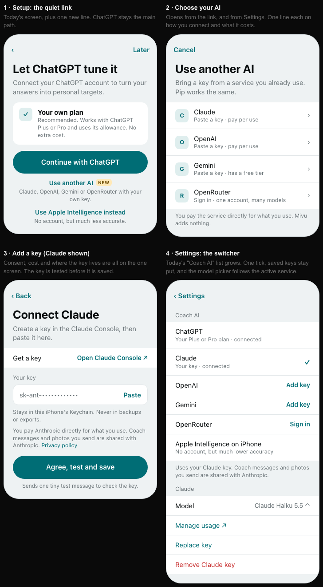

# Bring your own AI — design

Date: 2026-11-14. Base: `main` @ `90664b9a`. Branch: `docs/bring-your-own-ai-design`.

## Why

Today the full Coach needs a paid ChatGPT plan. The only other choice is the
on-device model, which is far less accurate. The owner wants a third way:
people bring a key from an AI service they already pay for, and Mivu uses it.

Three reasons, all confirmed by the owner:

1. **Reach.** People with no paid ChatGPT plan get the full Coach. A Gemini key
   has a free tier, so this can cost them nothing.
2. **Choice.** People who prefer Claude or Gemini can use it.
3. **Safety net.** If OpenAI changes or blocks plan sign-in, or app review
   objects to it, Mivu keeps working.

## Goals

1. A person can connect **Claude, OpenAI, Gemini or OpenRouter** with their own
   credential and get the same Coach as ChatGPT users: photo meals, questions,
   every Coach edit, and target tuning in setup.
2. **One active AI at a time**, chosen in Settings. Nothing switches by itself.
3. Setup keeps "Continue with ChatGPT" as the main button and adds one quiet
   link, "Use another AI".
4. Claude, OpenAI and Gemini connect by **pasting a key**. OpenRouter connects
   with a **sign-in button**, with no key to copy.
5. Mivu picks a cheap, photo-capable **default model** per service. The person
   can change it with the model picker Settings already has.
6. Before any data goes to a service, the person sees a **consent prompt that
   names that service**, the same pattern as today's OpenAI consent.
7. The person is told once, when connecting, that **they pay the service
   directly** and Mivu adds nothing. Settings links to that service's usage page.

## Non-goals

- No sign-in with a Claude Pro or Max plan. Anthropic allows plan sign-in only
  in its own apps. Claude here means a pay-per-use Claude Console key.
- No custom server address, and no local or self-hosted models.
- No QR-code key scanning.
- No usage or cost counter inside Mivu.
- No automatic fallback from one paid service to another.
- No promise that nutrition numbers match across models.
- No change to the ChatGPT sign-in or to the on-device model.
- No Android work in the first pull request. Android follows as its own pull
  request from this same design.

## Anti-goals (failure even if it "works")

- A key appears in a diary export, a folder backup, a log, a diagnostic string,
  a crash report or a screenshot fixture.
- Data reaches a service before the person agreed to share with that service.
- Mivu moves to a different paid service without the person choosing it, so
  they get a bill they did not expect.
- A rejected key or an empty balance leaves the person stuck with no
  explanation. The owner's rule is that the app recovers smoothly and people
  do not babysit failures.
- Switching service loses a capture. Captures are saved before analysis today
  and must stay that way.
- A reply that started on one service is continued on another mid-turn.

## Decided by the owner

- The four services at launch: Claude, OpenAI, Gemini, OpenRouter.
- One active AI, picked in Settings.
- Placement: quiet link in setup, full switcher in Settings.
- Paste for three services, sign-in button for OpenRouter.
- Mivu picks the default model, and the person can change it.
- Cost: one clear notice when connecting, plus a usage link.
- Consent: a separate prompt, like ChatGPT's, not folded into the save button.
- Order: iPhone first, Android right after.
- The four screens in the mockup above.

## Decided by the designer (owner has not ruled; check these)

- **Each service keeps its own saved credential.** Switching the active AI
  never deletes a key. Removing a key is an explicit, per-service action.
- **Keys are stored in the Keychain on this device only**, following
  `NutritionAPIKeyStore`, and are excluded from exports and backups.
- **The key is tested before it is saved**: one tiny request that sends no
  diary data. A key that fails the test is not saved and the screen says why.
- **Consent is recorded per service.** Agreeing to share with OpenAI does not
  cover Anthropic. Connecting an OpenAI key reuses the existing OpenAI consent
  wording, minus "through your ChatGPT account".
- **Failures**: Pip says what is wrong in one sentence with one action. Rejected
  key: "Replace key". Out of credit or rate limited: the service's usage link
  and "Try again". Captures stay saved and are analysed once the service works.
- **Own-key services tune setup targets**, as ChatGPT does. The on-device model
  still does not.
- **Default Claude model is Claude Haiku 5.5** (`claude-haiku-5-5`), because the
  owner chose a cheap default. Claude Sonnet 5.5 and Claude Opus 5.5 are in the
  picker. Estimates from the cheaper model may be less accurate.
- **OpenRouter's picker is a short fixed list**, not its whole catalogue of
  several hundred models.
- **Wording**: "Use another AI" for the link and the list title.

## How it works

### What exists

- `ChatGPTConnection` (`ios/Mivu/Connection/ChatGPTConnection.swift`) owns the
  choice of AI. It has `enum Provider { apple, chatGPT }`, stored under the
  `aiProvider` preference, and `inference()` returns one closure,
  `([CoachInferenceInput], Data?) -> CoachInferenceResult`. Coach, setup and
  Siri all call through that closure. This is the seam.
- `ResponsesClient` posts to `https://api.openai.com/v1/responses` with a
  bearer token, streams the reply and parses it into `CoachInferenceResult`.
- `AppleInference` already shows how a second provider plugs in: it returns
  output items in the same shape `CoachInferenceInput.priorOutput` validates.
- `NutritionAPIKeyStore` and its Settings section are a working example of a
  pasted key kept in the Keychain.
- `openAIConsent` is the consent prompt. `LoopbackCallback` and
  `NativeAuthorizationBrowser` already run a browser sign-in that returns to
  the app on a local address.

### What changes

- `Provider` gains four cases. Each has: a saved credential or none, a consent
  flag, a selected model, a "Get a key" link and a usage link.
- `inference()` gains one branch per new provider. Each branch returns the same
  closure type, so Coach, setup and Siri need no change beyond the places that
  ask "is ChatGPT connected" where they mean "can the active AI answer".
  Those are listed under *Places that assume ChatGPT*.
- Three wire formats are needed. Each adapter turns `CoachInferenceInput` and
  the tool list into its service's request, and turns the stream back into a
  `CoachInferenceResult`.

| Service | Wire format | New code |
|---|---|---|
| OpenAI key | Responses, as today | None. Same client, the key is the bearer token. |
| Claude | Anthropic Messages, native | One adapter. |
| Gemini | Chat Completions, Google's OpenAI-compatible address | One adapter, shared. |
| OpenRouter | Chat Completions | The same shared adapter with a different address. |

Claude uses its native format on purpose. Anthropic's own guidance is not to
reach Claude through an OpenAI-compatible shim.

### Service facts the builder needs

- **Claude.** `POST https://api.anthropic.com/v1/messages`, headers `x-api-key`
  and `anthropic-version: 2026-10-21`, `stream: true`. Tools use `input_schema`.
  Photos are `image` blocks with a base64 source. Model list:
  `GET /v1/models`. Thinking is on by default on current models; do not send
  `temperature`, `top_p`, `top_k` or `budget_tokens`. Within one tool loop,
  send the assistant's content back **unchanged**, thinking blocks included.
  Check `stop_reason` before reading content; `refusal` is a normal outcome and
  maps to a plain "Pip couldn't answer that" reply.
- **Gemini.** Base `https://generativelanguage.googleapis.com/v1beta/openai/`,
  key as a bearer token. Streaming, function tools and base64 photos are
  documented as supported. Google labels this layer beta. `GET /models` lists
  models, including ones that cannot chat, so the picker must filter.
- **OpenRouter.** Sign-in: open `https://openrouter.ai/auth` with
  `callback_url`, `code_challenge` and `code_challenge_method=S256`. Callbacks
  to localhost on any port are allowed, which fits `LoopbackCallback`. Exchange
  the code at `POST https://openrouter.ai/api/v1/auth/keys` with `code`,
  `code_verifier` and `code_challenge_method`. The reply's `key` is an API key
  the person controls and pays for. Store it like a pasted key.
- **OpenAI key.** Same endpoint as today. The Coach tool list is sent as one
  `namespace` tool. Confirm with a real key that a plain API key accepts that
  form; if it does not, send the functions as a flat list.

### Answered by the code

- **Photo meals and Siri use the seam.** A photo meal is a Coach turn with
  images, and `TellCoachIntent` calls `coach.captureExternal`. Both reach the
  model through `inference()`. `ProbeRunner`, `captureSample` and `canCapture`
  belong to the debug-only connection diagnostic. They stay ChatGPT-only and
  are out of scope.
- **Consent storage.** The existing `openAISharingConsent` preference keeps its
  name and meaning and covers both ChatGPT sign-in and an OpenAI key, because
  the recipient is OpenAI in both cases. Nobody who already agreed is asked
  again, and `restore()` keeps working. Anthropic, Google and OpenRouter each
  get their own new preference.
- **Key storage.** Add a small store keyed by provider, shaped like
  `NutritionAPIKeyStore`. Leave the USDA store untouched. A key is never
  written to `UserDefaults`, the diary database, `DiaryArchive` or a
  `ProbeJob`, which is what keeps it out of folder backups and exports.
- **State per provider.** Each key service has its own model list and selected
  model, so switching back restores the earlier choice. Saving, replacing or
  removing a key, and changing the active provider, bump `generation`, so
  requests in flight end as `sessionChanged`.
- **Model fallback.** When a model list loads and the saved model is not in
  it, today's code selects the first listed model
  (`ChatGPTConnection.loadModels`). Key services do the same, but prefer the
  provider's default model when it is listed.
- **Photo size.** Captured photos are at most 1600 pixels and 5,000,000 bytes
  (`PhotoCapture.swift`); typical ones are far smaller. Adapters send them as
  they are. A photo a service rejects for size is reported like any other
  failed request and the capture stays saved.

### Unverified until live testing

These are the places where a service may not behave as documented. The owner
chose to build before real keys are available, so the first pull request
builds to the documented behaviour, adds no speculative workarounds, and lists
these four as open. Each is the first thing to check once a key exists.

1. **Tool schema.** `CoachTools` uses `strict`, `additionalProperties` and
   nullable type arrays such as `["number", "null"]`. Claude accepts these as
   `input_schema`. Gemini's compatibility layer may not. If it rejects them,
   the shared adapter rewrites the schema for Gemini only; `CoachTools` itself
   does not fork.
2. **Tool names.** Calls come back today with `namespace: "mivu"`. Adapters
   send a flat function list and set that namespace on the calls they return.
3. **OpenRouter callback.** `LoopbackCallback` listens on
   `http://127.0.0.1:<port>/auth/callback` and validates an OAuth `state`.
   OpenRouter documents "localhost" callbacks and returns only `code`, plus
   `state` if one was sent. Confirm it accepts the `127.0.0.1` form. If it
   does not, OpenRouter ships with a pasted key in the first pull request and
   the button follows later. That fallback is the designer's call.
4. **OpenAI `namespace` tool with a plain key**, as noted above.

### Places that assume ChatGPT

These read `planAuthorized` or `provider == .chatGPT` and must work for any
connected service: `CoachView` (composer state), `TodayView` ("Analyzes when
ChatGPT is connected", and the resume on connect), `SettingsView` (summary row
and the Connection section), `OnboardingView` (the connect step, "ChatGPT is
tuning your targets…", "Tuned by ChatGPT"), `tunesTargets`, and
`ConnectionNotice` texts that name ChatGPT. Copy that names ChatGPT becomes
the active service's name, or "Coach AI" where no name fits.

### Screens

As in the mockup:

1. **Setup connect step**: unchanged, plus "Use another AI" and one caption.
2. **Use another AI**: four rows, each with how you connect and what it costs.
   Footer: "You pay the service directly for what you use. Mivu adds nothing."
3. **Connect a service**: a "Get a key" link, a secure paste field, where the
   key lives, the cost notice, then "Test and save". The consent prompt comes
   before this screen. For OpenRouter this screen is a sign-in button instead.
4. **Settings › Coach AI**: one list with ChatGPT, the four services and the
   on-device model. A tick marks the active one. Unconnected services show
   "Add key" or "Sign in". Below it, a section for the active service: model,
   Manage usage, Replace key, Remove key.

Accessibility rules in `AGENTS.md` apply: Dynamic Type, VoiceOver labels,
reduced motion, 44-point targets. English only.

## Constraints

- `AGENTS.md`: credentials in the Keychain, no bundled secrets, never log token
  responses, only synthetic inputs in diagnostics and tests, smallest failing
  test first, analysis kept separate from meal calculations.
- `ResponseFailureDiagnostic` builds text only from fixed allowlists. New
  adapters keep that rule; no service text is echoed into diagnostics.
- A request is bound to the provider, key and model it started with. If any of
  them changes mid-request, the request ends as `sessionChanged`, as it does
  today when the ChatGPT model changes.
- Android and iOS share no code. The Android pull request ports this design
  with its own files, and adds a `post-baseline` row to `docs/parity.md`.
- Hosted CI runs script checks only. Native tests run locally with
  XcodeBuildMCP, with the source SHA recorded.

## Left to the builder

- Type and file names, and whether `ChatGPTConnection` is renamed. Prefer not
  renaming in the first pull request.
- How Claude's thinking blocks ride through `priorOutput`, which today accepts
  only `message`, `function_call` and `reasoning` items.
- The exact default model ids for OpenAI, Gemini and OpenRouter, checked
  against each live model list at build time, and the OpenRouter short list.
- What happens when a saved model disappears from a service's list. Today's
  ChatGPT behaviour is to fall back to the first listed model.
- The split into commits and whether iOS lands as one pull request or two.

## Owner tasks outside the code

- **Privacy policy** at `mivuapp.com/privacy` must name Anthropic, Google and
  OpenRouter as possible recipients, chosen by the user.
- **App Store privacy answers** and the review notes should say that people may
  connect their own AI account, and that Mivu sells nothing.
- **Test credentials.** Owner ruling, 2026-11-14: build first and open the pull
  request, test with real keys afterwards. Until a service has had one real
  photo meal run through it, it is "built, not verified live", and the pull
  request and the verification record say so. A Claude Max plan does not
  provide a key: Claude testing needs a Claude Console account with a small
  prepaid balance. Gemini testing needs only a free Google AI Studio key.

## Sources

- [OpenRouter OAuth PKCE](https://openrouter.ai/docs/use-cases/oauth-pkce)
- [Gemini OpenAI compatibility](https://aistudio.google.com/docs/openai)
- [OpenRouter Responses API beta](https://openrouter.ai/docs/responses), read
  and not chosen: it is beta and its photo input is undocumented.
- Anthropic Messages API facts are from Anthropic's published API reference.
