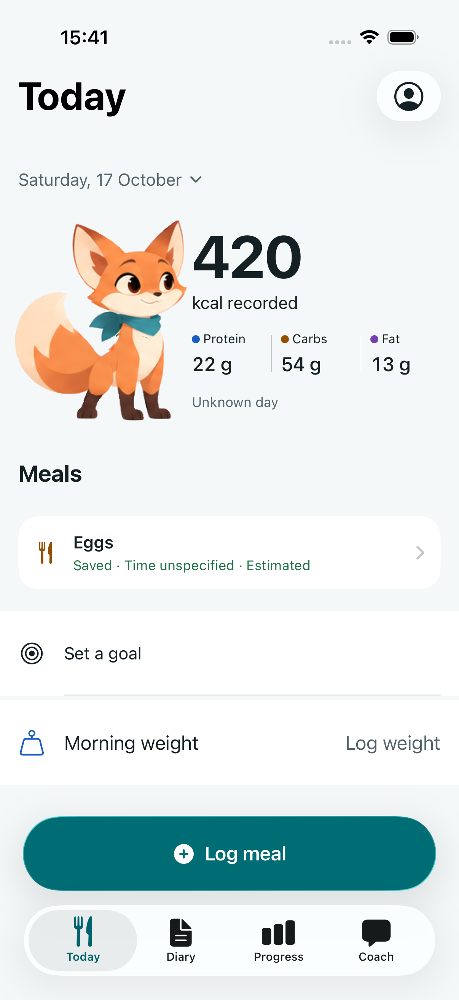
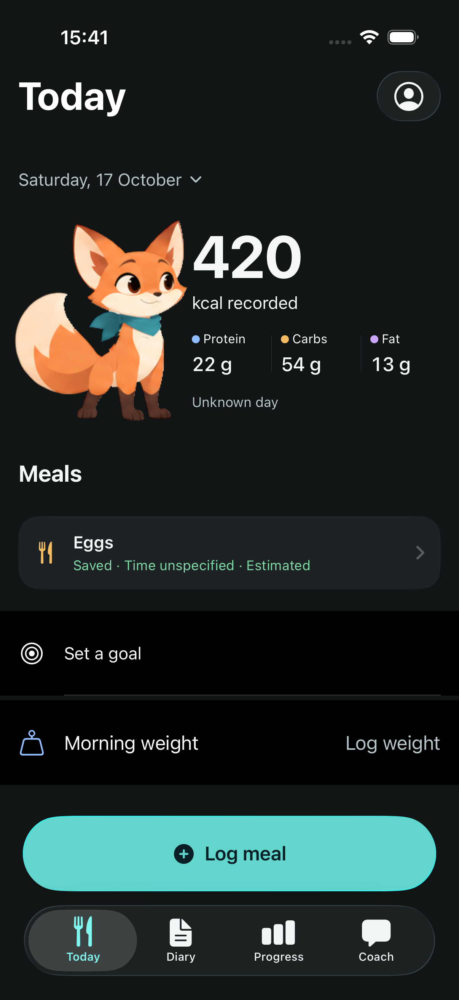
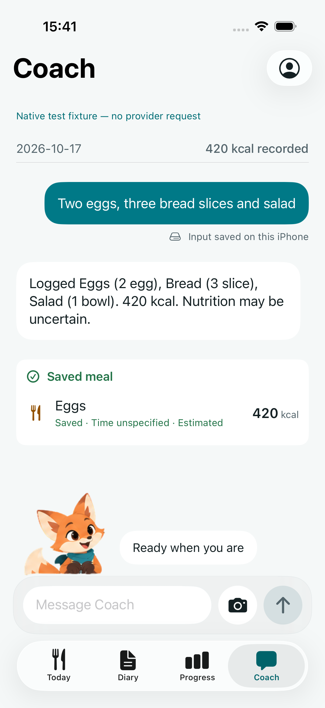
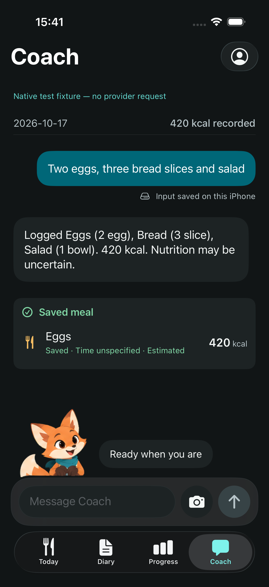

# Pip expressive motion verification

Motion/artwork source: `35dfa4a39a69724b5bfed29ff9e63c31d9f2a733`.
Retry integration: `102c7733e5d6d2136bb7e27657c4eaa078b263e1`.
Final caption layout and recorded screens: `b7e0642979c58f93ee36fa7a83906fbba85f4eda`.
This follow-up supersedes the motion acceptance of `3377cde`; the owner found
that pass's breathing almost invisible and its submit gesture too slow.
The original painted fox, screen composition and bundled Lottie 4.6.1 remain.

## Behavior and acting

- A chest joint carries the head and scarf through two four-second breaths in
  each eight-second idle loop. Idle/typing paws stay grounded. Ears articulate
  asymmetrically; tail and scarf follow the main movement.
- The accepted Coach send emits a profile/operation/attempt-scoped submission signal
  before its first await. Its 800 ms ear-perk/nod/paw-lift marker starts
  independently of persistence. A separately accepted retry gets a new transient
  attempt ID while durable capture stays idempotent. An explicit 80 ms snapshot
  bridges the outgoing breath phase while the new marker already plays.
- A fast durable receipt queues behind that gesture. Saved lasts 800 ms,
  reviewed 1 s and greeting 1.2 s. Data capture never waits for an animation.
- New errors, including repeated identical error text, interrupt acceptance.
  Only the unchanged error from before acceptance is suppressed while saving.
  Typing, hidden/covered/background, profile and motion-policy changes cancel
  stale reactions. Saved remains a durable-local-capture receipt.
- Coach shares a single painted rig across all markers. Ear masks retain the
  eyebrows and eyes under the rigid face. The authored JSON is 709,146 bytes,
  110 layers and 18 markers, versus 976,470 bytes and 162 layers previously.
  All original source and fallback PNG bytes are unchanged.

## Evidence

| Check | Result | Environment |
|---|---|---|
| Complete native units at `b7e0642`, mandatory push hook | 536 passed, 0 failed, 1 expected interactive sign-in skip | iPhone 18 Pro, iOS 27.0 simulator |
| Focused presenter, receipt, renderer, surface, root and mount checks at `35dfa4a` | 60 passed, 0 failed, 0 skipped | iPhone 17 Pro, iOS 26.5 simulator |
| Final full-loop idle/typing, submit and capture journey at `b7e0642` | 1 passed, 0 failed | iPhone 17 Pro, iOS 26.5 simulator |
| Retry regression suites at `102c773` | 50 passed, 0 failed, 0 skipped | iPhone 18 Pro, iOS 27.0 simulator |
| All five Progress journeys in isolation | 5 passed, 0 failed, 0 skipped | iPhone 18 Pro, iOS 27.0 simulator |
| Original Goals failure repeated at `102c773` | 1 passed, 0 failed, 117.600 s | iPhone 17 Pro, iOS 26.5 simulator |
| Generator rig/mask/motion regressions | 6 passed | Bundled Python, NumPy/Pillow |
| Script suite | 31 passed | Required push hook |
| Source/output provenance | All 26 hashes and recorded byte counts match | Current manifest |
| Complete UI suite, initial run | 34 passed, 3 failed; retained for investigation | iPhone 17 Pro, iOS 26.5 simulator |

The initial full UI run lost its application helper connection while clearing
goals after repeated animation-completion waits. The next test could not launch
the app; another reached Today but could not open Settings after an invalid
activation point. The last two Progress journeys passed. No new app crash was
found, and Pip was covered/stopped during the first stall, but this does not
establish a root cause. All five Progress journeys subsequently passed on iOS
27.0. The original Goals flow also passed on iOS 26.5 in 117.600 s at `102c773`,
with no Progress source or test changes. The original run remains failed and
must not be called a clean complete-suite pass.

Actual native 148-point samples check painted movement below the eyes, so a blink
alone cannot satisfy motion acceptance. Both submitted clips show body movement
at frame 6 (100 ms on the authored 60 fps timeline). The mounted player checks
playback within its first 100 ms and the short snapshot's visible opacity.
These are simulator/asset checks, not a physical input-to-photon measurement.

Core Animation playback is sampled from the presentation layer. The previous
`drawHierarchy` comparison could return the held model pose while real playback
advanced; the corrected check retains actual first/250 ms image attachments.
The native recording is inspected separately for composition and transitions.
Final dense light/dark submit frames show no overlapping labels, bubble overflow,
unrelated pose flashes or detached joints. The caption text and bubble update
together; the fox and keyboard keep the native focus transition. Earlier clips
are retained with source suffixes for comparison.

Native unit evidence: `native-vr_2ntgn/Mivu.xcresult` under the repository's local
hook evidence directory. Focused result: `test_sim_2026-10-17T11-39-57-311Z_pid97547_914ed2ed.xcresult`.
Final motion-journey result: `test_sim_2026-10-17T12-40-43-532Z_pid15176_fc8a71d4.xcresult`.
The latter bundles are in the local XcodeBuildMCP workspace's result directory.
The Goals repeat is `test_sim_2026-10-17T12-37-09-799Z_pid14496_7ab4dcf8.xcresult`;
iOS 27 Progress isolation is `test_sim_2026-10-17T12-23-11-446Z_pid9049_fd3dba26.xcresult`.

The primary workspace retains `output/pip-lottie-verification/2026-10-17-expressive/`:
the four native screenshots, a 96.673-second raw recording, a 58.4-second
review cut at original speed, and `verification.json` with paths and hashes.
The recorder's output-path parser failed on the workspace path; its actual saved
file was found, read by AVFoundation and copied successfully. Capture frame rate
varies and must not be reported as application frame rate.

| Today light | Today dark |
|---|---|
|  |  |

| Coach light | Coach dark |
|---|---|
|  |  |

## Remaining boundaries

Initial artwork preparation can take about one second, outlasting a short
reaction. The root applies whichever output remains current when ready; expired
reactions do not replay. A warm player is required for immediate animated
acknowledgment. Static fallbacks and native capture/status remain usable.

The signed Release at `b7e0642` is installed and launched on the connected iPhone
running iOS 27.0.1, preserving existing app data and using no fixture arguments.
The first installer connection failed; installation succeeded on retry. After
the owner unlocked the phone, launch succeeded with process ID **13252**.
The built phone bundle contains the same runtime JSON hash recorded above.
The simulator preview is also open in an isolated fixture profile (process 19218).
Frame pacing, energy, thermals, manual VoiceOver/system settings,
camera/provider behavior and haptics remain physical-device checks. The existing
private draft is [#17](https://github.com/yakov103/mivu/pull/17); no merge.
