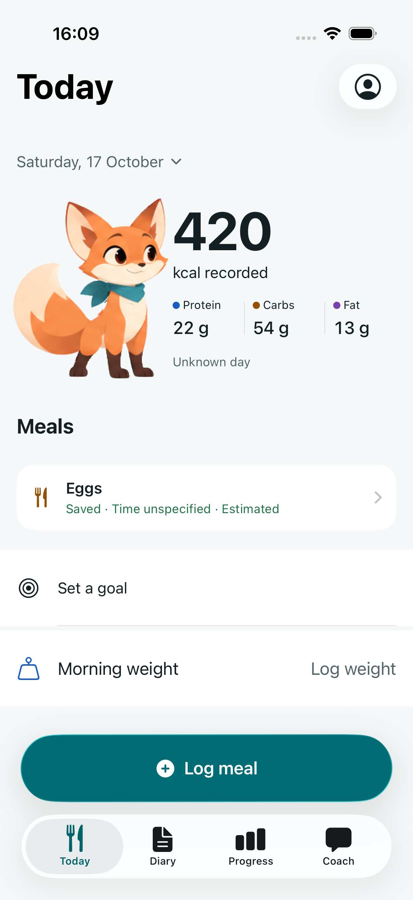
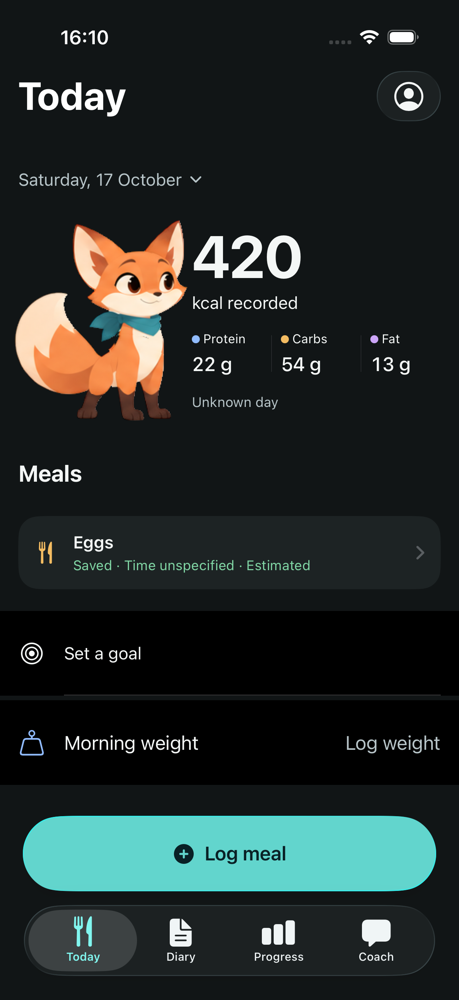
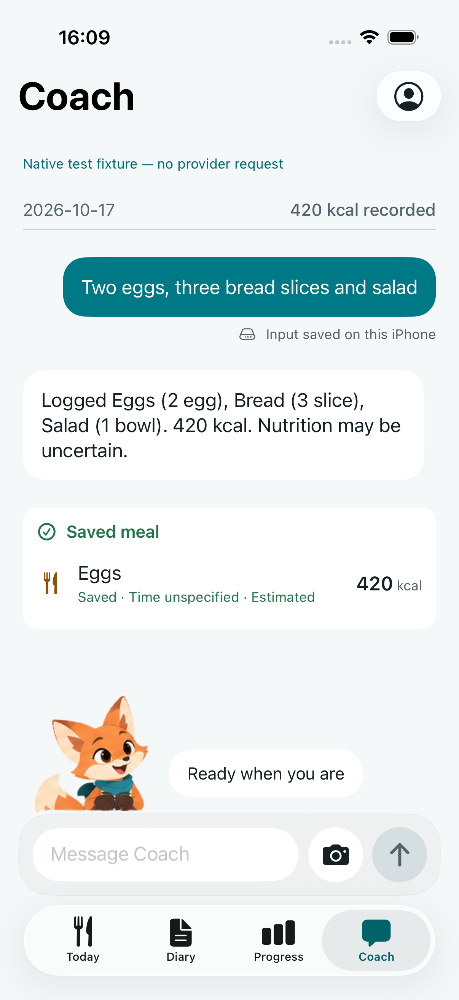
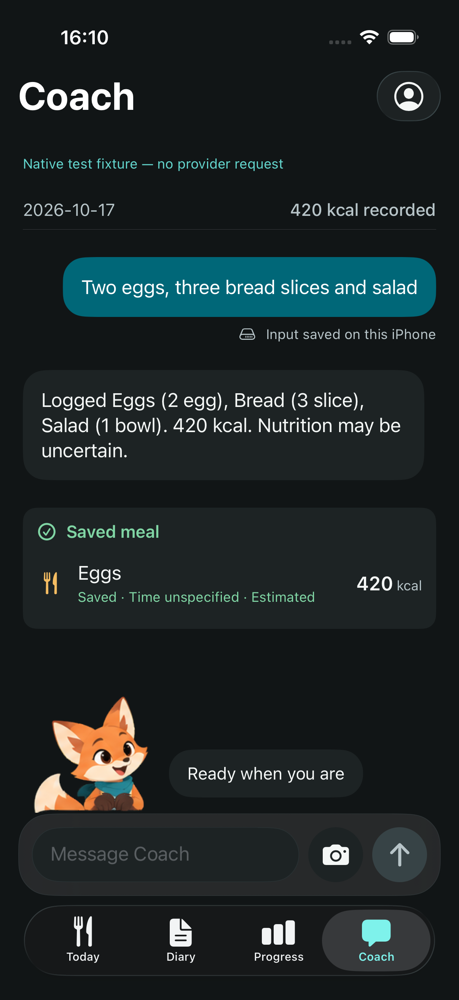
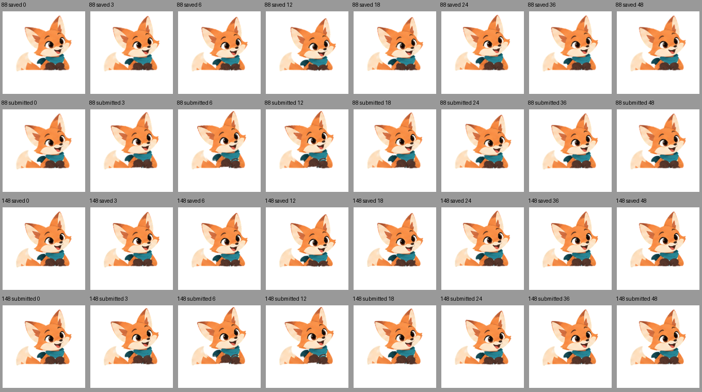

# Pip: stable Today idle and readable Coach acting

A later [complete premerge native run](2026-10-17-merge-validation.md) passed
577 tests, including all 37 UI cases, on iOS 26.5. The revision boundaries and
results below remain the evidence from this earlier motion correction.

Implementation source: `65bd63b850ad8378966fd9d38f3cf695fd5e32fc`.
This correction follows real-device review of `6e9d0f8`. Today breathing was
accepted; the owner reported an occasional other-pose flash while untouched,
and insufficient body acting on Coach food entry.

## Reproduced cause and correction

An empty background `CoachViewModel.recoverLegacyCaptures` check takes the shared
`diary.isSaving` persistence lock. Connectivity monitoring can start that work
without a user action. Today mapped the lock directly to `isProcessing`, so an
untouched breathing character briefly switched to the thinking painting and back.

A real SwiftUI-root regression holds the empty refresh at its actual await point.
Before the fix it fails three assertions: a non-resting output appears, the root
leaves resting, and the playing frame leaves the idle marker. Today now treats
background persistence independently of visual intent. Foreground capture remains
covered by its sheet; explicit durable save/review receipts still drive feedback.
No persistence locking, data or Coach processing behavior was changed.

The isolated renderer passed display-frame checks before this correction: a full
untouched idle cycle including blink/wrap, and greeting completion with nearby
presentation deadlines. Those checks support clip continuity; they are not the
RED reproduction of the root-level bug. No speculative renderer change was made.

## Coach choreography and paint integrity

Coach-specific keyframes now provide a clear chest/head lift and asymmetric ear
perk, wrist-led paw gesture, downward acknowledgment and delayed scarf/tail settle.
Submitted and saved each retain their 800 ms timings. Saved has its own down/up
chest nod; reviewed uses a restrained incline. Quiet Coach idle/typing gains 20%
more breathing/ear strength. The supporting paw stays fixed.

At the compact 88pt canvas, source geometry measures submitted face movement
2.507pt and paw movement 1.687pt; saved face/chest movement is 2.474/2.214pt.
These are authoring measurements, not device frame-rate or response-time claims.

Review of 96 native samples caught a detached paint fragment below the paws.
The scarf color selection included an isolated six-pixel teal patch at source
(98,136)–(101,137). It now stays on the anchored torso, outside moving-mask dilation;
only the main connected scarf component moves. A failing generated-mask/ground
regression was observed before correction, then all eleven Python checks passed.
The original source/runtime/fallback PNG bytes and all 98 Today layers/nine markers
remain unchanged. Neutral gesture endpoints and grounded joint contacts are checked.

## Evidence

| Check | Result |
|---|---|
| Actual root background-refresh RED | 5 passed, 1 failed; three assertions identify the unintended thinking pose |
| Focused native root, renderer, surface, receipt and presenter checks | 64 passed, 0 failed, 0 skipped before the final scarf mask correction |
| Generator acting, mask, contact and grounding checks | 11 passed, 0 failed |
| Final native compact/full-size render and light/dark UI journeys | 4 passed: one renderer check and three UI journeys; 0 failed/skipped |
| Mandatory complete native suite at `65bd63b` | 540 passed, 0 failed, 1 expected interactive sign-in skip |
| Physical Release deployment at `65bd63b` | Signed build installed and launched on connected iPhone iOS 27.0.1; process 13387 |

RED result: `test_sim_2026-10-17T13-03-24-872Z_pid25885_8a337e2f.xcresult`.
Focused GREEN: `test_sim_2026-10-17T13-04-24-295Z_pid26124_83504a36.xcresult`.
Complete native evidence: `native-su9a_ezh/Mivu.xcresult` under the local hook
evidence directory; the check also ran all 31 script tests successfully.
These remain in the local XcodeBuildMCP workspace result directory.

The longer UI recording leaves Today untouched for three complete eight-second
cycles in each appearance, then exercises quiet typing, accepted food input and
its saved feedback. Largest system text and typing during feedback are checked
separately. Final native frames confirm the lower scarf fragment is removed at
saved frames 6/12/18 in both themes/sizes, with intact facial paint and joints.
Independent review found no new blocker in the sampled idle or transition frames.
The review video is 86.6 seconds at original speed; a separate eight-second
Coach food-entry comparison and the 173.3-second raw recording are retained.
Capture rate is variable and is not an application frame-rate measurement.

Final renderer/UI result: `test_sim_2026-10-17T13-08-22-171Z_pid26966_4addd9e2.xcresult`.
Media, hashes and exact paths are in the primary workspace’s
`output/pip-lottie-verification/2026-10-17-idle-and-coach/`.
The native screenshots and acting-frame board are also committed below.

| Today light | Today dark |
|---|---|
|  |  |

| Coach light | Coach dark |
|---|---|
|  |  |

## Research and delivery boundaries

The pinned [Lottie 4.6.1 playback implementation](https://github.com/airbnb/lottie-ios/blob/4.6.1/Sources/Public/Animation/LottieAnimationLayer.swift)
and [Core Animation implementation](https://github.com/airbnb/lottie-ios/blob/4.6.1/Sources/Private/CoreAnimation/CoreAnimationLayer.swift)
were inspected: clip setup is deferred to a display pass, so an app state change
must first be proven before treating an apparent flash as a renderer fault.
Coach keeps one painted rig with neutral joins and no artwork swapping; native
keyboard sizing stays separate from the Lottie layer tree.

The existing complete UI run at `35dfa4a` remains a historical failed run
(34 passed, 3 failed). Subsequent Progress isolation passed on iOS 27.0 and the
original Goals flow passed on iOS 26.5, as recorded in the previous report. This
correction does not claim a new complete 37-test UI run.

The signed Release is installed in place on the connected iPhone, with no fixture
arguments or data reset. Its bundled runtime JSON hash matches the verified asset.
After the owner unlocked the phone, launch succeeded with process 13387. The simulator
preview also built and launched successfully on iPhone 17 Pro / iOS 26.5.

The private PR remains a draft; no merge. Physical frame pacing, energy, thermals,
manual VoiceOver/system settings, camera/provider and haptic acceptance remain
unmeasured. A simulator recording's capture rate is not the application's FPS.
