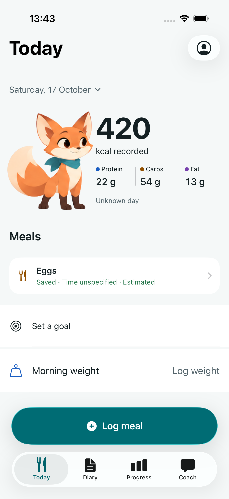
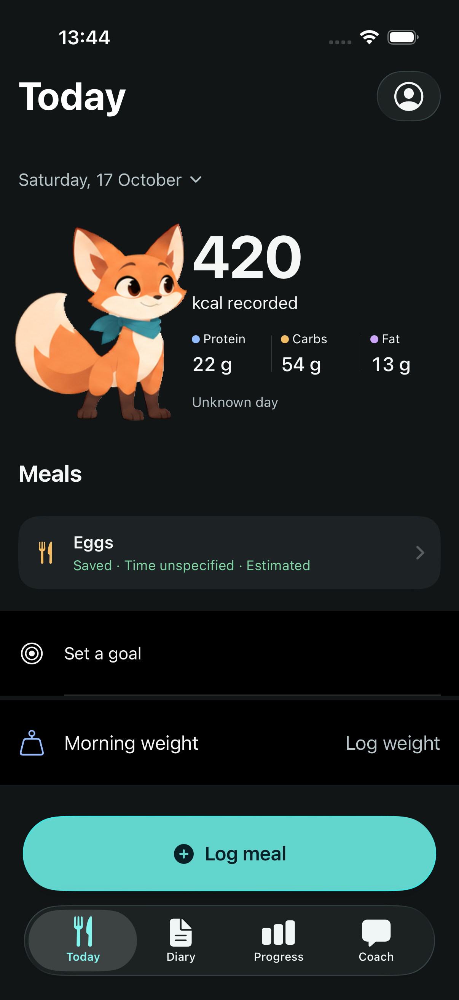
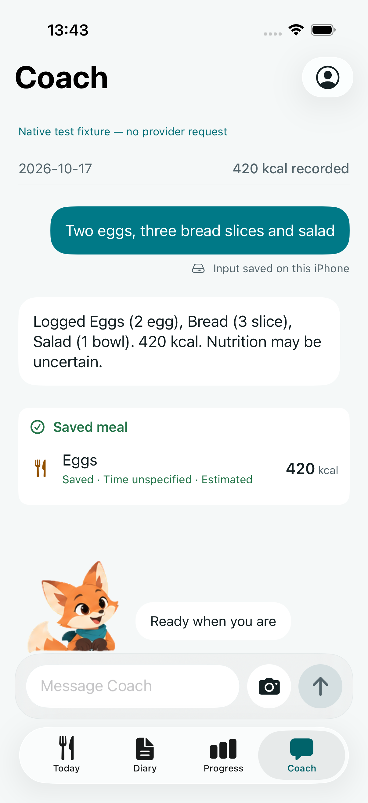
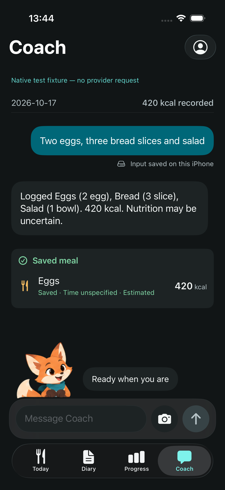

# Illustrated Pip with Lottie — simulator evidence

The current implementation uses the approved shaded fox painting, not the
superseded simplified Rive asset. The owner’s later request for continuously
living, slower motion supersedes the original guide’s held idle and short
reactions. Physical-device acceptance remains pending.

## Reference and implementation

- Original guide: `design-system/mivu/characters/pip/character-sheet.pdf`, SHA-256
  `d1f2def8b63f3bc2dc809054cd3feb93ddbac38dd638267fcfa0021357d0f07c`.
- The bundled atlas is byte-identical to `storyboard.png`, SHA-256
  `5bef0e0459bf52c26fde44170c4b9419d0d4e4154779f51b0d01fdd1fd9166e1`.
  Coach uses the exact seated painting from `context.png`. Only registered
  eyelid patches alter the painted eye regions.
- Official Lottie 4.6.1 is pinned, with its Apache license bundled. Native tests
  confirm the actual Core Animation renderer, rendered pixels, repeated clips,
  natural completion, and lifecycle behavior. The 60 fps authoring timeline is
  not a measurement of device frame rate.
- Resting is an 8-second living loop; typing is a quieter 6-second loop;
  thinking/recovery loop over 4 seconds. Saved/reviewed/greeting last
  1.5/1.8/2.2 seconds and return to living idle. Motion uses independent painted
  head, torso, ears, scarf and tail parts with grounded feet or paws.
- Coach retains one registered seated rig across semantic states. Today fades
  a snapshot over 350 ms when changing paintings. Timeline changes run outside
  implicit UIKit animation; screen changes use the native tab transition.
- Appearance updates do not restart loops. Hidden, covered, background, Reduce
  Motion, Low Power Mode, and serious thermal conditions stop decorative work.
  Native text carries status; saving, navigation and typing never await Pip.

## Recorded visual inspection

The native Device Hub recording from iPhone 17 Pro / iOS 26.5 includes a complete
idle cycle, quiet typing, capture, and light/dark layouts. The review preview is
53.2 seconds, concatenating source ranges 19–46 and 52–78.2 seconds; no images were
retouched or frames interpolated. Four full native screenshots accompany it; these were refreshed after the
final cold-load fix. The recording is from `6707440`; the isolated follow-up
changes loading feedback delivery, with unchanged artwork and motion timelines.

Local deliverables are in the primary workspace’s
`output/pip-lottie-verification/2026-10-17/`: the MP4, Today/Coach light/dark PNGs,
and `verification.json` with source ranges and file hashes. The four screenshots
are also committed in [`pip-lottie/`](pip-lottie/) for portable review. These local output
files are not portable repository attachments. Original result bundles remain
at the paths recorded in XcodeBuildMCP JSON under
`/private/tmp/mivu-lottie-verification/`.

A first recording revealed unrelated atlas paintings flashing during implicit
view transitions. A native pixel regression reproduced the defect; changing
only a view-transition option still failed. Isolating the timeline update and
using a separate Today snapshot removed the defect. Dense native transition
frames were inspected again, including focus resizing and idle-loop boundaries.
Whole-screen native tab crossfades remain normal platform behavior.

## Checks

| Check | Source / result |
| --- | --- |
| Mandatory full native units | `c0623c3`: 523 passed, 0 failed, 1 expected interactive-authentication skip; pre-push result `native-hvx6aj55` |
| Renderer, full idle cycle, pixel flash regression, mount and surface checks | 6 passed, 0 failed (`transition-isolated-green.json`) |
| Final recorded light/dark capture and quiet typing | 1 passed, 0 failed (`final-recorded-ui.json`) |
| Two previously failing Coach journeys | 2 passed, 0 failed after accessibility/reveal corrections (`coach-accessibility-green.json`) |
| Complete UI suite | `6707440`: 37 passed, 0 failed, 0 skipped, 1,049,517 ms (`final-all-ui.json`) |
| Cold-load fresh-save regression and lifecycle checks | `c0623c3`: 47 passed, 0 failed (`cold-save-green-booted.json`); both current and expired saves tested |
| Final light/dark capture after the cold-load fix | `c0623c3`: 1 passed, 0 failed, 69,791 ms (`cold-final-ui.json`) |

The Coach corrections keep the largest-text status compact and begin oversized
replies at readable content rather than positioning an oversized action card
above the viewport. The history test uses measured, bounded gestures toward the
target; it retains its visibility assertions.

Independent reviews covered runtime, presentation, mounting, source artwork,
package integration, and the whole production branch. Review found a cold-load
feedback edge case; its fix passed a real gated-load integration regression
for both current and expired saves and was independently reviewed again. No native data reset
or live provider request was used; fixture records are UUID-isolated synthetic
content.

## Owner’s connected-iPhone acceptance

Simulator evidence does not establish physical Release frame pacing, CPU/GPU
cost, memory, battery, thermals, camera/provider behavior, haptics, or manual
VoiceOver quality. The private [draft #17](https://github.com/yakov103/mivu/pull/17) is for review and the owner’s phone test;
it must not be treated as a release or merge approval.

## Native screens

| Today light | Today dark |
| --- | --- |
|  |  |

| Coach light | Coach dark |
| --- | --- |
|  |  |

## Delivery

Private draft #17 is stacked on the open Precision color update (#16), with
hosted checks passing at `c0623c3`. The tested app was built, installed and
launched on the iPhone 17 Pro simulator in a separate synthetic fixture profile;
no real diary was reset. Later documentation-only commits retain identical
native inputs and reuse the required native evidence through the pre-push hook.
